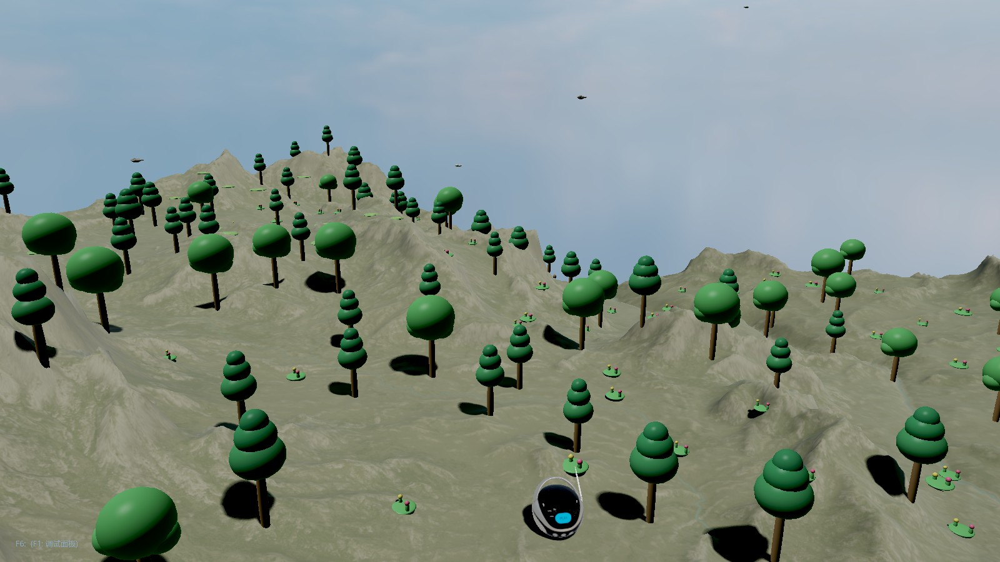
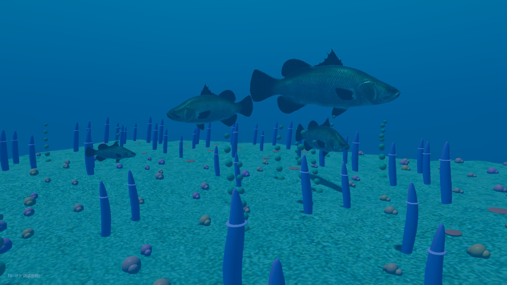
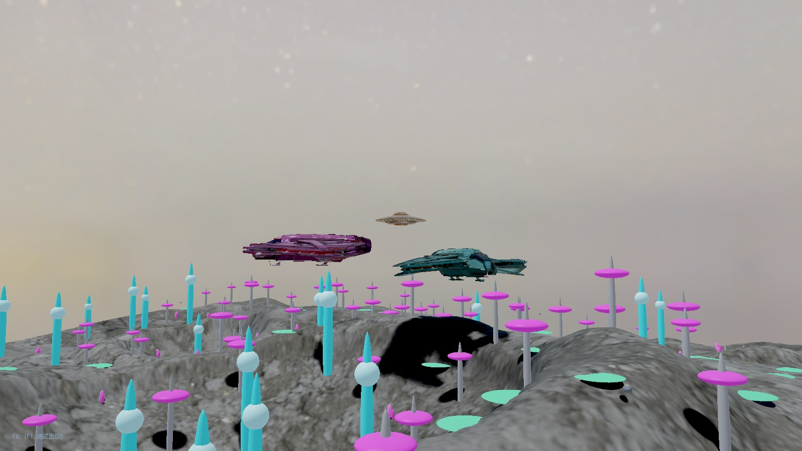
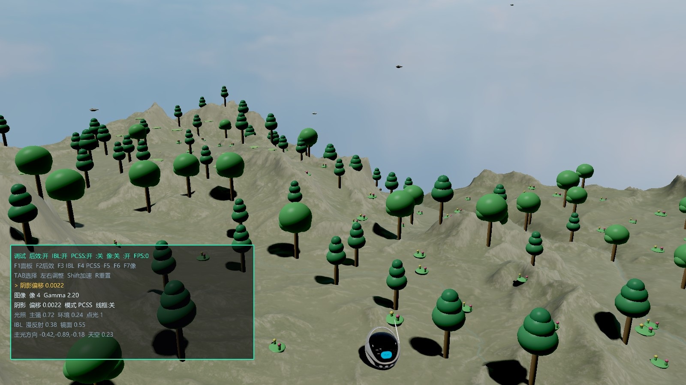
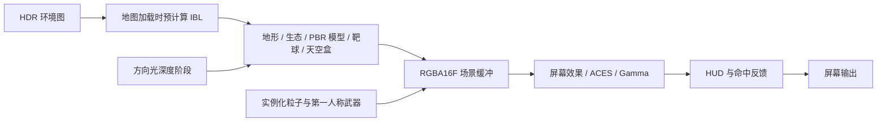

<h1 align="center">AimLab</h1>

<p align="center"><strong>用 C++ 与 OpenGL，从渲染管线到一次命中的完整反馈。</strong></p>
<p align="center">A real-time rendering playground with first-person aim training.</p>

<p align="center">
  
  
  
  
  
</p>

<p align="center">
  <a href="#实机预览">实机预览</a> ·
  <a href="#技术亮点">技术亮点</a> ·
  <a href="#快速开始">快速开始</a> ·
  <a href="#操作说明">操作说明</a> ·
  <a href="docs/architecture.md">实现与取舍</a>
</p>

---

AimLab 是一个将**实时渲染实验与第一人称瞄准交互**结合的个人项目。使用 C++17 和 OpenGL 3.3 Core Profile，实现 PBR / IBL、接触软阴影、高度图地形、屏幕后处理，以及射线命中、计分和粒子反馈。

项目关注两个问题：**如何让材质在不同环境光下保持合理的表现，以及如何把渲染、资源和玩法组织成可维护的程序。** 三套 JSON 配置场景和运行时调试开关，让效果可以直接观察、比较和解释。

## 实机预览



<p align="center"><em>Nature · 高度图山地 / HDR 环境光 / PBR 展示模型</em></p>

<table>
  <tr>
    <td width="50%"></td>
    <td width="50%"></td>
  </tr>
  <tr>
    <td align="center"><strong>Ocean</strong><br>海床地形、水下扭曲与色彩衰减</td>
    <td align="center"><strong>Crater Base</strong><br>陨石坑、飞船模型与彩色点光源</td>
  </tr>
</table>

<details>
<summary><strong>查看运行时调试面板</strong></summary>



通过 `F1` 展开面板，比较 IBL、PCF / PCSS 风格软阴影、水下与像素化效果；可直接调节阴影偏移和像素大小。

</details>

以上图片均为程序固定视角下的实机截图，使用自由相机隐藏武器和普通 HUD。场景中的模型、纹理和环境图包含第三方素材。

## 技术亮点

| 方向 | 实际实现 | 代码入口 |
| --- | --- | --- |
| **PBR 与环境光照** | Cook–Torrance BRDF、GGX 与 Split-Sum IBL；HDR 环境图预计算 irradiance、粗糙度预滤波 cubemap 和 BRDF LUT | [PBR shader](shaders/pbr_model.fs) · [资源预计算](src/resource_manager.cpp) |
| **动态阴影** | 4096² 方向光深度图；Poisson PCF、遮挡物搜索与可变滤波半径的 PCSS 风格软阴影；法线相关深度偏移 | [阴影阶段](src/shadow_pass_renderer.cpp) · [地形 shader](shaders/terrain.fs) |
| **HDR 与后处理** | RGBA16F 场景缓冲；ACES 色调映射、gamma 校正；配置驱动的曝光、对比度、饱和度与暗角，支持水下扭曲和像素化 | [后处理](src/post_process_renderer.cpp) · [合成 shader](shaders/post_process.fs) |
| **地形与场景** | 8 / 16 位高度图、法线生成和世界坐标高度查询；JSON 描述天空盒、灯光、模型、出生点与靶场参数 | [地形](src/terrain.cpp) · [场景配置](resources/maps_config.json) |
| **射击反馈** | 射线与球体求交、最近命中选择、中心精度与距离奖励、连击、命中标记、后坐力和屏幕震动 | [射线检测](src/raycast.cpp) · [计分](src/score_system.cpp) |
| **粒子与对象复用** | CPU 更新粒子，GPU 实例化绘制；固定 2,000 容量对象池与 free list，批量上传活跃实例 | [粒子系统](src/particle_system.cpp) |
| **模块化资源管理** | 独立渲染阶段、RAII 与 `std::unique_ptr` 所有权、局部 GL 状态保护；同一地图内按模型路径复用资源 | [主循环组织](src/game_manager.cpp) · [地图资源](src/map_resource_loader.cpp) |

### 渲染流程



更详细的 CPU / GPU 分工、资源生命周期、算法边界与改进方向，见 [实现与取舍](docs/architecture.md)。

## 快速开始

### 环境与依赖

- **Windows x64**，Visual Studio 2022，安装“使用 C++ 的桌面开发”、v143 工具集及 Windows SDK。
- 支持 **OpenGL 3.3 Core** 的图形驱动。
- 外部依赖：GLFW、GLAD（OpenGL 3.3 loader）、GLM、Assimp。将它们的头文件放入可配置的 include 目录，并准备 x64 MSVC 链接库。
- 仓库已包含 GLAD 的 C 实现、stb、nlohmann/json 和场景资源；外部依赖的头文件与 `.lib` 需要自行准备。

```powershell
git clone https://github.com/Fragrant0/AimLab.git
cd AimLab
```

### 构建与运行

在 PowerShell 中配置自己的依赖路径，以下路径仅作示例；多个目录使用分号分隔：

```powershell
$env:AIMLAB_INCLUDE_DIRS = 'D:\deps\include'
$env:AIMLAB_LIBRARY_DIRS = 'D:\deps\glfw\lib;D:\deps\assimp\lib'
powershell -NoProfile -ExecutionPolicy Bypass -File .\scripts\build.ps1
```

脚本自动定位 VS 2022 的 MSBuild，默认构建 **Debug x64**，也可通过 `-MSBuildPath` 指定位置。已经使用个人 VS 属性表配置依赖时，可以省略上述环境变量。

```powershell
$env:PATH = "$PWD\DLL;$env:PATH"
.\x64\Debug\opengl_try.exe
```

**从仓库根目录运行**，以便读取 `shaders/` 和 `resources/`。Debug 配置链接 `glfw3.lib`、`opengl32.lib` 与 `assimp-vc143-mtd.lib`；运行时 DLL 版本需与链接库匹配，详见 [DLL 说明](DLL/README.md)。

<details>
<summary><strong>使用 Visual Studio 或 Release 配置</strong></summary>

打开 `opengl_try.sln`，选择 `Debug | x64`。通过个人属性表配置第三方 include / library 路径，将调试工作目录设为 `$(ProjectDir)`，并把 `DLL/` 加入运行环境的 `PATH`。

```powershell
powershell -NoProfile -ExecutionPolicy Bypass -File .\scripts\build.ps1 -Configuration Release
```

Release 配置需要额外准备对应的 `assimp-vc143-mt.lib` 与匹配 DLL；仓库提供的 DLL 为 Debug 版本。第三方库应与目标架构、配置及 MSVC 运行库匹配，当前验证以 Debug x64 为主。

</details>

### 启动冒烟检查

```powershell
powershell -NoProfile -ExecutionPolicy Bypass -File .\scripts\smoke_build_run.ps1 -RunSeconds 15
```

脚本重新构建、启动程序，检查地图、IBL、模型与字体初始化，并拒绝提前退出和已知错误日志。日志写入 `tmp/smoke_run.log`、`tmp/smoke_run.err.log`。它需要图形桌面与 OpenGL 驱动；交互和视觉效果仍需手动验证。

构建后可额外运行初始化失败回归：

```powershell
powershell -NoProfile -ExecutionPolicy Bypass -File .\scripts\check_startup_failures.ps1
```

该检查在 `tmp/` 的独立副本中测试缺失 shader、GLSL 编译与链接错误，以及 IBL、字体和后处理的晚期失败。故障必须返回退出码 `1` 并报告对应阶段；原始资源不会修改。

<details>
<summary><strong>复现固定视角截图</strong></summary>

从根目录运行，先按上文设置 DLL 搜索路径并创建输出目录：

```powershell
New-Item -ItemType Directory -Force tmp
.\x64\Debug\opengl_try.exe --capture 1 tmp\nature.ppm
.\x64\Debug\opengl_try.exe --capture 0 tmp\ocean.ppm
.\x64\Debug\opengl_try.exe --capture 2 tmp\crater.ppm
.\x64\Debug\opengl_try.exe --capture 1 tmp\debug.ppm --debug-overlay
```

`--capture` 在隐藏窗口中渲染固定视角，输出 1600 × 900 的 PPM 图片后退出；OpenGL 错误或写入失败返回非零状态。仍需可用的图形驱动。README 中的 JPEG 由该输出转换，截图模式不用于性能基准。

</details>

## 操作说明

| 按键 | 功能 |
| --- | --- |
| `W A S D` / 鼠标 / 滚轮 | 移动 / 观察 / 调整视野 |
| `Shift` / 鼠标左键 | 加速 / 单次射击 |
| `1` / `2` / `3` | 切换 Ocean / Nature / Crater Base，默认进入 Nature |
| `Space` / `Esc` | 切换线框 / 退出 |
| `F1` | 显示调试面板 |
| `F2` | 启用或禁用已选择的水下、像素化效果；保留色调映射与色彩调整 |
| `F3` / `F4` | 切换 PBR 模型 IBL / PCF 与 PCSS 风格软阴影 |
| `F5` / `F7` | 切换水下效果 / 像素化 |
| `F6` / `Q E` | 自由相机 / 自由相机下降、上升 |
| `Tab` / `← →`（或 `- +`） | 选择调试参数 / 减小、增大；按住 `Shift` 加大步长 |
| `R` | 恢复调试默认设置 |

## 工程结构

```text
AimLab/
├── include/                  # 玩法、资源与渲染模块头文件
├── src/                      # main、GameManager 及各模块实现
├── shaders/                  # GLSL 渲染阶段
├── resources/
│   ├── maps_config.json      # 地图、光照、地形与展示模型配置
│   ├── objects/              # glTF / OBJ 模型及材质
│   ├── textures/             # 地表、heightmap 与 HDR 环境图
│   └── fonts/                # HUD 字体
├── scripts/                  # 构建、启动检查与程序化资源生成
├── docs/                     # 实机截图与实现说明
└── opengl_try.sln            # Visual Studio 解决方案
```

## 当前边界与后续方向

- 地图切换为**同步加载**，会重新加载资源并计算 IBL；尚未实现后台流式加载或 JSON 文件热重载。
- 粒子采用 **CPU 模拟 + GPU 实例化绘制**，当前容量为 2,000；后续补齐规模测试与 CPU / GPU 帧时基准。
- 射击检测针对靶球，尚未加入完整的地形与场景模型遮挡检测。
- 软阴影使用经验半影近似；稳定阴影投影、天空盒旋转与 IBL 方向同步、全场景颜色空间一致性仍有改进空间。
- Bloom 提取与模糊 shader 尚未接入当前渲染管线；后续计划补齐合成与可复现的效果对比。

欢迎通过 issue 讨论渲染问题或复现情况。贡献约定见 [Repository Guidelines](AGENTS.md)。

## 依赖与参考

[GLFW](https://www.glfw.org/) · [GLAD](https://github.com/Dav1dde/glad) · [GLM](https://github.com/g-truc/glm) · [Assimp](https://github.com/assimp/assimp) · [stb](https://github.com/nothings/stb) · [nlohmann/json](https://github.com/nlohmann/json)

图形学学习参考：[LearnOpenGL](https://learnopengl.com/)。部分资源目录附有第三方许可文件，使用或分发素材前请核对各自许可。
